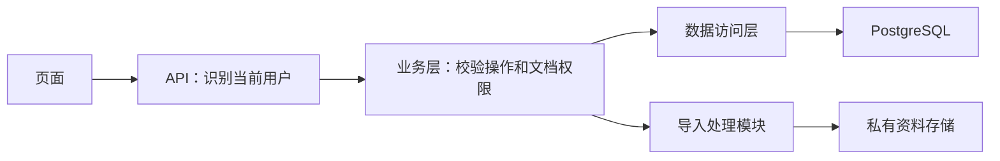

# B0 技术设计

状态：草案，尚未实现。

## 设计目标

实现 TXT 导入、授权检索和引用预览。


## 技术栈与职责

| 技术 | 项目职责 |
| --- | --- |
| React + TypeScript | 构建上传、检索和引用预览页面 |
| FastAPI | 接收 HTTP 请求，组织接口处理 |
| Pydantic | 校验接口字段的类型与格式 |
| Python 业务模块 | 判断业务权限，组织导入、检索和引用流程 |
| PostgreSQL | 保存文档、版本、授权关系和可检索片段 |
| 私有资料存储 | 保存原始资料，由后端控制访问 |

pgvector、持久任务与 Worker 继承参考规划，
在对应增量中细化接入方式，本轮尚未实现。

## 模块调用关系



## 三条业务路径

1. 导入：识别用户 → 校验导入权限 → 校验文件 → 保存资料并处理片段。
2. 检索：识别用户 → 限定可阅读的文档 → 在授权范围内匹配 → 返回片段和来源。
3. 引用：识别用户 → 再次校验目标文档阅读权 → 返回对应版本与位置的原文。

## 权限与失败边界

- 当前用户由服务端依据可信身份确定。
- Pydantic 字段校验通过，不代表用户具有业务权限。
- 管理权限与正文阅读权限分别判断。
- 未授权资料不进入检索响应。
- 打开引用时重新校验权限。
- 导入失败的资料不产生可检索内容。
- 无匹配结果时返回明确的空结果。

## ADR-01：采用模块化单体

状态：草案，沿用参考规划的设计方向。
背景：当前由一人开发，需要先交付一条可运行流程。
决策：API、权限和业务规则先在同一个后端应用内按模块组织。
替代方案：将各模块拆成独立服务。
取舍：减少部署和跨服务调用的复杂度；模块边界需要在代码中维护。
复议条件：实际负载或团队分工证明需要独立部署与扩容。

## ADR-02：B0 演示身份识别

状态：草案，尚未实现。

背景：B0 需要区分管理员、员工甲和员工乙，
并验证用户不能通过修改请求中的身份字段冒充他人。

决策：使用随机演示令牌，由服务端配置令牌与身份的映射。
请求通过 Authorization 请求头携带 Bearer 令牌。
服务端验证令牌后，确定当前用户、租户和角色。

客户端提交的用户、租户或角色字段不能改变当前身份。
文档阅读权限仍根据当前用户和目标文档单独检查。

演示令牌通过本地配置提供，不写入源代码或提交 Git。
演示认证仅在显式启用的本地演示和测试环境使用。
正式部署前另行设计正式身份接入方案。

替代方案：现在实现完整登录系统，或立即接入企业身份服务。
取舍：演示令牌能先验证权限流程，但需要手工配置和分发，
并且不具备正式登录、会话管理和账号生命周期管理能力。

### 预期行为

- 未携带令牌或令牌无效：返回 401，不执行业务操作。
- 员工身份请求导入：返回 403，拒绝操作。
- 员工乙检索：不返回其无权阅读的资料。
- 员工乙直接请求受限引用：拒绝访问，不返回原文。
- 修改请求中的用户或租户字段：不能切换服务端识别出的身份。
## ADR-03：B0 核心数据关系

状态：草案，尚未建表。

背景：检索结果必须同时关联文档、具体版本和阅读权限。

决策：分别保存文档、版本、阅读授权和文本片段。
采用参考规划中的 PostgreSQL 作为这些业务数据的存储。

| 数据表 | 职责 | 初步字段 |
| --- | --- | --- |
| documents | 文档身份与基本信息 | id、tenant_id、title、status |
| document_versions | 某份文档的具体版本 | id、tenant_id、document_id、version_no、storage_key、content_hash、normalized_text |
| document_acl | 文档阅读授权 | tenant_id、document_id、subject_type、subject_id、permission |
| chunks | 可检索且能定位来源的文本片段 | id、tenant_id、version_id、locator、text |

### 字段含义

- id：当前记录的唯一标识。
- tenant_id：资料或授权所属的租户。
- title：文档标题。
- document_id：关联的文档标识。
- version_no：同一文档内的版本序号。
- storage_key：原始资料在私有存储中的位置标识。
- content_hash：内容摘要，用于检测内容变化。
- subject_type：被授权主体的类型，B0 先限定为 user。
- subject_id：被授权用户的标识，与服务端识别出的用户对应。
- permission：允许的操作，B0 阅读授权使用 read。
- version_id：片段所属的具体版本标识。
- locator：片段在该版本原文中的位置，具体格式待细化。
- text：用于检索和展示的片段正文。

### 数据规则

1. 同一文档可以关联多个版本，同一版本可以关联多个片段。
2. 版本序号在同一租户、同一文档内唯一。
3. 版本发布后的正文保持不变；修改内容应创建新版本。
4. 子记录与关联的文档或版本必须属于同一租户。
5. B0 授权主体必须是服务端演示配置中的同租户用户。
6. 同一租户、文档、主体和权限组合不重复保存。
7. 没有匹配的阅读授权记录，就没有该文档的阅读权限。
8. 管理员身份不自动产生 read 授权。

替代方案：把文档、正文、用户权限和片段放进一张大表。
取舍：分表能减少重复数据并表达版本归属，
但查询时需要关联数据，建表时需要补齐主外键与索引。

### 演示数据安排

演示初始化为员工甲建立指定文档的 read 授权。
员工乙不建立该文档的 read 授权。
管理员默认不建立正文阅读授权。
B0 先通过受控演示初始化准备授权数据，授权管理界面另行安排。


### 关联规则

- 一份文档可以拥有多个版本。
- 一个版本可以拥有多个文本片段。
- 每个片段必须能找到所属版本和文档。
- 文档、版本、片段及授权关系必须保持租户归属一致。
- 阅读授权关联用户和文档。
- 没有匹配的阅读授权，就不能读取该文档及其片段。
- 管理员身份不自动获得文档阅读权限。

替代方案：将正文、版本、用户权限和片段放在一张大表中。
取舍：分表减少重复信息、明确数据归属，
但需要关联查询，并在建表时设置主外键和索引。

具体字段、约束和索引在后续设计中补齐。
## B0 文档处理状态

documents.status 保存文档当前的处理状态。
B0 先实现首次导入流程。

正常流程：
received → parsing → indexing → ready

状态含义：
- received：已受理并建立文档记录，等待处理。
- parsing：读取并校验文本内容。
- indexing：生成片段并准备可检索数据。
- ready：处理完成，可以参与授权检索。
- failed：处理失败，不参与检索。

处理规则：
1. 接收阶段的身份、权限或输入校验失败，直接拒绝请求。
2. 文档受理后，在 received、parsing 或 indexing 阶段处理失败，进入 failed。
3. 进入 ready 前，必须确认版本、片段和来源定位数据完整。
4. 数据库内的片段发布与 ready 状态更新应保持事务一致。
5. 检索和引用访问同时检查租户归属、ready 状态和 read 授权。
6. 失败原因应可追踪，返回给用户的信息不能包含密钥或内部堆栈。

同步或异步处理方式、重试和故障恢复在后续设计中明确。
## B0 原文定位规则

### 原始资料与定位文本

原始文件保存在私有存储中，通过 storage_key 定位。
content_hash 使用原始文件字节计算 SHA-256 摘要。

文件按 UTF-8 严格解码，解码失败则拒绝处理。
将 CRLF 和 CR 换行统一为 LF，其他文字内容保持不变。
结果保存为 document_versions.normalized_text。

检索片段和引用展示均以该版本的 normalized_text 为依据。
版本发布后，这份文本不可原地修改。

### 片段位置

B0 按完整行组织片段，暂不在一行内部切分。
规范化文本按 LF 分行，空行保留，行号从 1 开始。

chunks.locator 使用以下 JSON 结构：

```json
{
  "start_line": 2,
  "end_line": 3
}
```

start_line 是起始行，end_line 是结束行，首尾均包含。
二者必须是整数，并满足：
1 ≤ start_line ≤ end_line ≤ 文本总行数。

chunks.text 等于该范围内各行按 LF 连接后的文本。

### 打开引用

1. 根据片段标识查找所属版本和文档。
2. 校验当前租户、文档 ready 状态及当前用户的 read 授权。
3. 使用服务端保存的 locator 读取该版本的 normalized_text。
4. 返回文档标识、版本标识、行号和对应文本。

客户端不能通过自行提交行号绕过文档阅读权限。
定位越界或片段与来源文本不一致时，拒绝返回并记录错误。

### 方案取舍

按行定位便于演示和人工核验。
它暂不支持行内精细定位，具体分块大小另行确定。

## B0 检索接口：请求约定

目的:让已认证用户检索自己有权的资料
当前为设计草案，接口尚未实现

### 请求形式
```http
POST /api/v1/search
Authorization: Bearer <演示令牌>
Content-Type: application/json

{
  "query": "报销",
  "top_k": 3
}
```
示例中的演示令牌是占位符。

### 输入规则

- query：必填字符串，去除首尾空白后，长度为 1～2000 个字符。
- top_k：可选整数，默认 10，允许范围为 1～20。
- 请求体只接受 query 和 top_k，额外字段拒绝接收。
- 当前用户、租户和角色由服务端验证令牌后确定。
- 只在当前用户有权阅读且状态为 ready 的文档中检索。
- top_k 表示最多返回的条数，不保证一定有这么多结果。
## B0 检索接口：响应约定

当前为设计草案，尚无接口运行结果。

### 成功响应

请求有效且检索正常完成时，返回 HTTP 200。
响应体中的 items 保存本次检索结果。

下面的 ID 为说明用示例，实际 ID 由服务端生成。

```json
{
  "items": [
    {
      "chunk_id": "chunk_example",
      "document_id": "doc_example",
      "document_title": "报销规则（演示）",
      "version_id": "version_example",
      "version_no": 1,
      "locator": {
        "start_line": 2,
        "end_line": 3
      },
      "text": "先提交申请\n审批通过后报销"
    }
  ]
}
```

### 无匹配结果

在当前用户有权阅读的 ready 文档中没有匹配片段时，
仍返回 HTTP 200，响应体如下：

```json
{
  "items": []
}
```

用户没有任何可阅读文档时，也返回相同的空结果结构。
响应不说明其他用户可见的资料是否存在。

### 返回规则

- items 中每项表示一个匹配片段。
- 每个片段必须满足当前租户、ready 状态和 read 授权条件。
- 返回数量不超过 top_k，允许少于 top_k。
- text、版本和 locator 必须指向同一份来源内容。
- 返回来源标题和标识前，也必须通过阅读权限检查。
- 打开引用时重新校验权限，不能只依赖检索时的检查。

### 失败响应

- 401：令牌缺失或无效。
- 422：请求字段不符合输入规则。
- 503：数据库等必要依赖暂时不可用。
- 500：未预期的服务端错误。

服务故障不能伪装成 HTTP 200 和空结果。
失败响应不返回密钥、数据库连接信息或内部堆栈。
具体错误响应体在通用错误约定中统一定义。
## 待细化

身份解析、数据字段、文档处理状态、
检索规则、接口输入输出及错误响应。

## 面向订单履约的设计增量

> 范围说明：本节属于第二领域包（订单履约），B0 首轮不实现。B0 的业务对象和验收以 [招聘服务公司领域需求](./08_招聘服务公司领域需求.md) 和 [今日任务](./09_今日任务-2026-11-08.md) 为准。

本设计在原 B0 文档权限底座上加入外贸与供应链的业务对象，但保持模块化单体起步。业务对象和规则服务负责确定事实、状态、权限和动作，Agent 只负责查询规划、证据整理和草稿生成。

### 业务对象

| 对象 | 核心字段 | 来源与时效 |
| --- | --- | --- |
| customer | tenant_id、external_id、国家/地区、语言、客户状态 | CRM 或合成快照 |
| sku | tenant_id、external_id、规格、包装、合规标签 | ERP/OMS/商品库 |
| supplier | tenant_id、external_id、准入状态、交期、质量记录 | ERP/采购系统 |
| order | tenant_id、external_id、客户、SKU、数量、承诺日期、状态 | ERP/OMS |
| inventory_snapshot | tenant_id、sku、可用量、锁定量、as_of | WMS/ERP |
| document_requirement | order_type、目的地、单证类型、required、effective_from | 制度和单证模板 |
| shipment_event | order_id、节点、状态、event_at、source | TMS/货代接口 |
| exception | order_id、类别、级别、证据、责任角色、状态、rule_version | 规则服务 |

所有业务对象都有来源系统、外部 ID、更新时间或版本、租户和字段分类。易变事实优先实时工具查询，制度和历史记录进入版本化检索。

### 业务调用路径

1. 服务端解析身份并确定租户、角色和权限版本。
2. 领域服务读取订单上下文和授权对象集合。
3. 检索层只在授权集合内查询制度、规格书、供应商说明和历史记录。
4. 规则服务计算延期、库存不足、单证缺失和物流超时等异常。
5. Agent 组织来源、缺失字段和下一步草稿，不能修改领域状态。
6. 工具代理根据工具等级、参数、对象版本和审批状态返回预览或拒绝。
7. 审计服务保存授权决策、来源、规则、模型、工具和结果。

### 连接器接口草案

    class ReadConnector(Protocol):
        connector_id: str
        version: str

        def fetch(
            self,
            *,
            tenant_id: str,
            object_type: str,
            external_id: str,
            actor_id: str,
        ) -> ConnectorResult:
            ...

ConnectorResult 至少包含 source_system、external_id、object_type、data、as_of、cursor、field_mapping_version 和 warnings。连接器不能接收客户端提供的租户或权限结果作为信任依据，运行上下文由服务端注入。

### 工具契约草案

B0 只实现两个预览工具。

- create_follow_up_task：输入订单、异常、责任角色、截止时间和幂等键，输出待办预览。
- add_order_note_preview：输入订单、备注草稿、来源和幂等键，输出字段变化预览。

工具输入使用 Pydantic Schema，动作前再次校验当前主体、对象版本、策略版本和审批状态。B0 不调用真实系统写接口。

### 当前设计状态

原有 TXT 导入、演示身份、文档版本、ACL、行号引用和搜索响应仍为设计草案，尚无代码或业务测试证明。业务对象、连接器、工具预览、审计和安全基线已写入规划，但尚未实现。实现时先建立最小数据模型和权限测试，再逐步加入模型调用。
