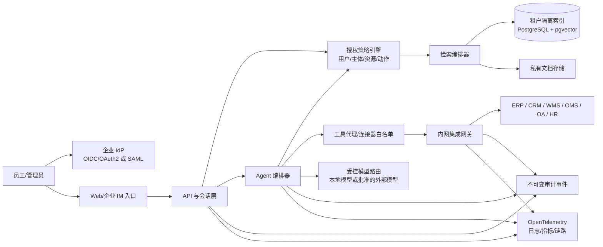

# 企业级定制 Agent 架构与安全边界

状态：规划基线，待与首个目标企业访谈后确认。
适用范围：在现有“企业知识与权限治理 RAG”B0 基础上，逐步扩展为可接入企业内部系统的定制 Agent 平台。
证据边界：本文是可执行设计与验收基线，不代表已经接入任何真实企业、完成安全认证或产生商业结果。

## 1. 产品边界与不可替代性

产品不以“通用聊天”作为核心价值，而以企业的私有资料、角色权限、业务规则、内部系统连接器和可审计流程形成客户专属运行面。每个客户交付一套可配置的领域包，至少包含以下内容：

1. **领域词汇与对象模型**：例如采购单、供应商、SKU、报价、交期、库存、质检、客户投诉等，由目标企业确认字段含义。
2. **企业流程与政策包**：将审批条件、例外处理、时效规则和责任人映射为版本化规则，不能只依靠提示词记忆。
3. **企业数据连接器**：对接客户实际使用的 ERP、CRM、WMS、OMS、OA、HR、钉钉、飞书、企业微信、文件盘或数据库只读副本。每个连接器记录数据来源、同步频率、字段映射和失败重试策略。
4. **可验证输出**：回答必须携带来源文档、数据时间、权限判断和工具调用记录。涉及写操作时先给出预览和影响范围，再按授权执行。
5. **客户专属评测集**：使用客户脱敏样本建立问题、期望来源、允许动作、拒答条件和时效指标。每次规则、模型或连接器变化都运行回归评测。

因此，通用 Agent 可以提供语言能力，但无法直接替代客户已经确认的领域模型、权限关系、流程策略、连接器适配、审计证据和评测集。产品仍需用可量化的交付证据证明价值，不能把“定制”当成自动成立的结论。

## 2. 总体架构

先采用模块化单体加独立集成网关，待实际负载和团队分工证明需要时再拆分服务。集成网关优先部署在客户内网或客户控制的私有云，通过出站连接访问平台，避免平台直接进入客户内网。



### 2.1 组件职责

| 组件 | 必须承担的责任 | 不允许承担的责任 |
| --- | --- | --- |
| API 与会话层 | 解析可信身份、限流、输入校验、统一错误、请求关联 ID | 接受客户端提交的 user_id、tenant_id 作为身份依据 |
| 授权策略引擎 | 判断主体对租户、文档、字段、工具和动作的权限；返回 allow/deny 与理由 | 依赖模型自行判断是否可访问 |
| 检索编排器 | 在授权范围内检索、重排、生成引用和拒答 | 先检索全部资料再在前端隐藏 |
| Agent 编排器 | 规划步骤、调用受限工具、生成预览、触发人工审批 | 直接持有业务系统管理员凭据或绕过审批写入系统 |
| 工具代理/连接器 | 只暴露版本化的最小工具，校验输入、超时、幂等键和响应结构 | 暴露任意 SQL、任意 HTTP 或任意脚本执行 |
| 内网集成网关 | 出站连接、凭据隔离、网络白名单、系统适配、断线重试 | 将客户内网开放为平台的通用入口 |
| 审计与观测 | 记录主体、策略版本、来源、工具、审批、结果和 trace_id | 记录未脱敏的完整密钥或不必要的敏感正文 |

## 3. 身份、租户和授权模型

### 3.1 身份接入

正式企业部署使用客户 IdP。浏览器入口采用 OIDC/OAuth 2.0 授权码流程并启用 PKCE，服务端验证签发方、受众、签名、过期时间、租户和主体标识。企业员工同步可选 SCIM，第一版也可通过受控 CSV/API 导入，但必须保留禁用和离职处理流程。

演示令牌只保留在 B0 本地演示和测试环境。生产环境不得依赖手工共享令牌。

### 3.2 授权决策输入

每次检索、打开引用、调用工具和执行写操作都使用以下最小决策输入：

```text
subject: {tenant_id, user_id, groups, status}
resource: {resource_type, resource_id, data_classification}
action: read | search | export | invoke_tool | approve | write
context: {request_id, source_ip, client, purpose, time}
policy_version: 当前生效的策略版本
```

授权至少支持租户、部门/群组、用户、文档、文档版本、字段分类、工具和动作七个维度。管理员拥有“管理授权”的能力不等于自动拥有资料正文的阅读权，延续 B0 已确认的分离原则。

### 3.3 数据库防线

业务表统一带 `tenant_id`，文档、版本、片段、授权、连接器凭据引用、工具执行记录和审计事件不得跨租户关联。PostgreSQL Row-Level Security 作为数据库层的纵深防线，策略采用默认拒绝，并在应用层和数据库层各做一次租户/主体约束。数据库表所有者、超级用户和 `BYPASSRLS` 角色可能绕过 RLS，生产连接不得使用这些高权限角色。见 PostgreSQL 官方行级安全文档。

## 4. RAG 与知识治理

### 4.1 导入与发布

资料进入 `received → scanning → parsing → indexing → pending_review → ready → revoked` 状态机。只有 `ready` 版本可被检索。每个版本保存原始文件哈希、规范化文本、来源系统、导入人、分类级别、策略版本和发布时间。撤销后立即阻断检索和引用，并触发索引删除或失效标记。

### 4.2 授权先于检索

检索查询先根据主体和策略得到可见资源集合，再将租户、文档和字段过滤条件下推到向量/关键词查询。不得在不受限全集索引中召回后再靠提示词隐藏。高敏感客户可按租户或部门建立独立索引，普通客户使用带强制 ACL 元数据的共享索引。

### 4.3 引用与时效

每个返回片段必须绑定 `document_id`、`version_id`、定位信息、来源系统和 `as_of` 时间。打开引用时重新执行授权检查，不能复用检索时的结果。对 ERP/库存/订单等易变数据，优先实时工具查询，RAG 只负责制度、说明和历史记录。

## 5. 系统集成边界

### 5.1 连接方式优先级

1. 官方 API 或企业服务总线。
2. 客户批准的数据库只读副本或视图。
3. 文件、SFTP、Webhook 或定时导出。
4. 无 API 时才评估浏览器自动化，并单独做账号、验证码、审计和变更风险评估。

禁止把生产库管理员账号、任意 SQL、任意脚本和任意 URL 作为通用 Agent 工具。

### 5.2 工具分级

| 级别 | 例子 | 默认策略 |
| --- | --- | --- |
| T0 只读 | 查询订单状态、查询库存、查制度 | 可自动执行，返回来源和时间 |
| T1 低风险写入 | 建立草稿、生成报价草案、创建待审批任务 | 自动生成预览，需业务负责人确认 |
| T2 高风险写入 | 修改订单、发起付款、变更供应商或人事资料 | 强制人工审批、二次确认、幂等键和审计 |
| T3 禁止 | 删除生产数据、导出全量敏感数据、任意代码执行 | 产品层和连接器层同时拒绝 |

所有工具都必须有：版本号、输入 JSON Schema、输出 Schema、最小 OAuth scope/服务账号权限、超时、重试上限、幂等策略、敏感字段处理和审计事件。

### 5.3 写操作控制

写操作采用 `plan → preview → approve → execute → verify` 五步。审批单显示目标系统、对象、字段变化、影响范围、发起人、审批人和策略版本。执行失败时不得自动重复可能产生副作用的请求，连接器使用幂等键和状态查询。支持回滚时优先调用业务系统的补偿接口，并把无法回滚的动作标为人工处置。

## 6. 安全基线

安全要求按 OWASP ASVS 5.0、OWASP GenAI/LLM 风险清单和 NIST AI RMF 组织，首版至少落地以下控制：

- **身份与会话**：OIDC/OAuth2、PKCE、短时访问令牌、刷新令牌轮换、离职禁用、管理员强制 MFA（由客户 IdP 提供）。
- **网络**：TLS 1.2 及以上、内网网关仅出站、域名/IP 白名单、模型供应商白名单、管理端与业务端分离。
- **数据**：传输和存储加密、租户隔离、数据分类、最小化发送到外部模型、敏感字段脱敏、可配置保留期和删除证明。
- **提示词与工具**：把外部文档视为不可信输入，系统策略与文档内容分层；工具采用 allow-list、参数校验、沙箱、限时和审批；对提示词注入、越权检索、敏感信息泄露和不安全输出建立红队用例。
- **凭据**：连接器只保存密钥引用，真实密钥放入客户批准的密钥管理系统；日志禁止记录 token、密码、完整身份证号和完整业务机密。
- **审计**：记录登录、授权变更、检索、引用打开、工具计划、审批、执行、失败、撤销和导出。审计事件至少含主体、租户、资源、动作、结果、策略版本、模型/连接器版本、时间、request_id 和 trace_id，并采用追加写或 WORM 存储。
- **供应链**：锁定依赖版本、生成 SBOM、镜像签名、漏洞扫描、密钥轮换和变更审批。

安全验收以可复现测试为准，不能只凭“部署在内网”宣称安全。

## 7. 可观测性与企业验收

采用 OpenTelemetry 统一 trace、metric 和 log。每次用户请求关联 `request_id` 与 `trace_id`，并串联授权决策、检索、模型调用、工具调用和审批。指标至少包括：授权拒绝率、越权测试通过率、引用可验证率、检索延迟、工具成功率、审批耗时、连接器失败率、数据撤销生效时间和敏感信息拦截次数。

首个企业试点的通过条件：

| 类别 | 可验收条件 |
| --- | --- |
| 业务价值 | 用客户确认的 20～50 个真实脱敏问题，回答/检索结果达到约定准确率，所有结果可定位来源或明确拒答 |
| 权限安全 | 通过跨租户、离职用户、撤销授权、越权引用、提示词注入和工具越权测试；无未授权正文泄露 |
| 系统接入 | 至少一个真实系统以只读方式接通，断线、超时、限流和字段映射有测试证据 |
| 可审计 | 随机抽查请求可还原主体、策略、来源、模型、工具、审批和结果 |
| 运营交付 | 客户管理员能独立配置用户/群组、资料分类、连接器开关、审批人和保留策略 |
| HR/面试/甲方材料 | 交付架构图、数据流图、威胁模型、API/字段映射、测试报告、部署与回滚手册、已知限制和变更记录 |

## 8. 分阶段落地顺序

### B0：权限治理 RAG 纵向切片

保留当前 TXT 导入、文档版本、授权检索、引用预览和演示身份。补充租户字段、撤销状态、审计事件、越权测试和最小 OpenTelemetry 埋点。B0 不宣称已具备生产登录、真实系统接入或企业认证。

### B1：企业身份与真实连接器只读接入

接入一个 OIDC 企业 IdP 和一个真实系统的只读 API/视图。完成连接器契约、同步状态、失败重试、字段分类、数据新鲜度、审计导出和客户试点评测集。

### B2：定制领域 Agent

引入领域对象模型、规则包、T0/T1 工具、来源引用、实时数据查询和客户可维护的评测集。工具全部经过策略引擎和连接器白名单。

### B3：受控写操作与正式交付

只针对客户批准的 T1/T2 动作实现审批、幂等、执行验证、补偿/回滚和操作手册。完成安全测试、备份恢复、容量与故障演练，形成可被 HR、技术面试官和甲方审查的交付证据包。

## 9. 必须由客户确认的边界

以下事项不能由开发者单方面假设，需在首个客户访谈中形成签字或邮件确认：

- 目标行业、首个可量化业务问题、现有系统和数据负责人。
- 身份源、组织/群组同步方式、离职时限和管理员职责。
- 数据分类、可出域范围、模型供应商、保留期、删除与备份要求。
- 第一批只读和写入工具、审批角色、失败补偿和停用条件。
- 试点数据集、准确率/时延/越权零泄露指标、验收人和复盘周期。

## 参考标准与官方文档

- [NIST AI Risk Management Framework 1.0](https://www.nist.gov/publications/artificial-intelligence-risk-management-framework-ai-rmf-10)
- [OWASP Application Security Verification Standard 5.0](https://asvs.owasp.org/)
- [OWASP Top 10 for Large Language Model Applications](https://owasp.org/www-project-top-10-for-large-language-model-applications/)
- [RFC 9700 OAuth 2.0 Security Best Current Practice](https://www.rfc-editor.org/info/rfc9700/)
- [RFC 7636 Proof Key for Code Exchange](https://www.rfc-editor.org/info/rfc7636/)
- [RFC 7644 SCIM Protocol](https://www.rfc-editor.org/info/rfc7644/)
- [PostgreSQL Row Security Policies](https://www.postgresql.org/docs/current/ddl-rowsecurity.html)
- [OpenTelemetry Observability Primer](https://opentelemetry.io/docs/concepts/observability-primer/)


## 招聘服务公司的领域增量

首个领域包把订单替换为职位交付和候选人证据。核心对象包括 client_company、job_order、candidate、resume_version、interview_plan、interview_record、background_check、placement_case、employment_case 和 consent_record。候选人资料访问必须同时满足客户项目范围、候选人同意范围、顾问角色和字段级策略。

候选人联系方式、身份证明、薪资、背调和劳动关系资料按字段分类。面试官可以看到岗位相关资料和面试计划，不能默认看到完整背调、薪资或其他客户项目的候选人信息。推荐报告必须回链到简历版本、面试记录、背调结果或客户确认的岗位条件。

ATS、招聘 CRM、简历库、企业邮箱、企业微信、钉钉、飞书、OA、合同和人事系统采用同一连接器契约。T0 工具读取职位、候选人授权状态、面试状态和入职任务。T1 工具生成面试任务或推荐报告草稿。录用、合同、派遣、工资、社保、离职和发送外部消息属于高风险动作，进入审批、幂等和执行验证流程。

